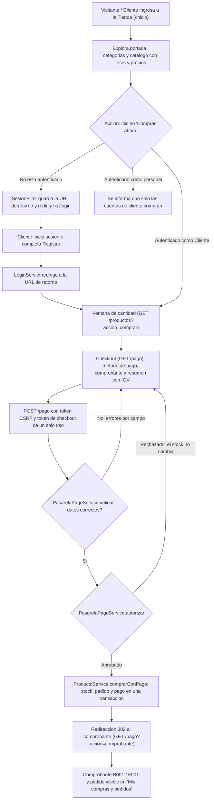

# Bitácora y Proceso Técnico: Reestructuración de NEXORA a Tienda Online

Este documento describe de forma cronológica, técnica y metodológica todas las acciones realizadas para transformar el sistema web **NEXORA** de un panel de control de inventario genérico a una **Tienda Online de Equipamiento Tecnológico (eCommerce)** completa, intuitiva y orientada al cliente, con **pasarela de pago simulada** y comprobante de pago.

---

## 1. Diagnóstico Inicial y Planteamiento del Problema

### Situación previa
La versión anterior del sistema presentaba los siguientes inconvenientes de diseño y experiencia de usuario:
1. **Inicio genérico de tipo panel de administración (Dashboard):** Al acceder a la página de inicio, cualquier usuario o cliente observaba de inmediato tarjetas de indicadores estadísticos (valorización en soles de todo el inventario, conteo de stock agotado, existencias internas y listas de accesos administrativos).
2. **Inadecuado para un rol de Cliente o Visitante:** Un comprador que entra a una tienda virtual no necesita ver balances internos ni números de almacén; requiere un catálogo visual atractivo, productos con fotografías reales, precios claros y botones directos de compra.
3. **Ausencia de recursos visuales:** Los productos solo se mostraban en tablas de datos o listas de texto plano, sin imágenes.
4. **Flujo de compra rígido:** No existía una separación clara entre la navegación pública del catálogo y la acción protegida de compra, ni un pago ni un comprobante asociados al pedido.

---

## 2. Objetivos de la Reestructuración

1. **Diseño eCommerce Auténtico:** Rediseñar la portada (`inicio.jsp`) y las vistas de catálogo para ofrecer una experiencia propia de las tiendas modernas de tecnología y computación.
2. **Fotografías Reales y Locales:** Asociar a cada producto del catálogo (`P001` a `P012`) una fotografía almacenada en el propio proyecto (`img/productos/`), de modo que la tienda no dependa de servidores externos; el origen de cada foto queda documentado en `docs/fuentes-imagenes.json`.
3. **Flujo de Compra Contextual:** Permitir que cualquier visitante explore libremente el catálogo, categorías y precios; al decidir comprar (**Comprar ahora**), el sistema solicita inicio de sesión o registro y retorna automáticamente a la ventana de cantidad del producto elegido, sin perder la selección.
4. **Pasarela de Pago Simulada:** Completar la compra con un checkout (tarjeta o Yape), validación del pago, descuento de stock solo cuando el pago es aprobado y emisión de boleta o factura.
5. **Segregación Estricta de Perfiles:** Reservar la compra únicamente al rol `Cliente`; el registro y la edición de productos, a `Administrador` y `Almacén`; la eliminación, a `Administrador`; y los reportes, al personal (no a los clientes).
6. **Módulo de Administración:** Dar al personal pedidos con estados, anulación con reembolso, kardex de inventario, reportes de ventas, gestión de usuarios y categorías, y auditoría (véase la sección 8).

---

## 3. Arquitectura del Flujo de Usuario y Compra

---

## 4. Modificaciones Técnicas por Archivo

### A. Modelo de Dominio: [`Producto.java`](src/main/java/pe/edu/sistema/model/Producto.java) y modelos de pago
`Producto` conserva únicamente los datos del inventario: código, nombre, categoría, precio y stock. El estado se deriva del stock (un producto sin existencias siempre figura como *Agotado*, aunque se intente fijar otro valor) y expone `getPrecioTexto()`, `getValorInventarioTexto()` e `isDisponible()`. **No** guarda imagen, valoraciones ni descuentos: la fotografía se asigna en la vista (véase la sección 5).

Para la compra se añadieron modelos nuevos:
* **[`Pago`](src/main/java/pe/edu/sistema/model/Pago.java):** método (`TARJETA` o `YAPE`), marca, últimos dígitos, titular, monto, estado (`Aprobado` o `Rechazado`), códigos de autorización y operación, tipo y número de comprobante, documento del cliente y razón social. Calcula subtotal e IGV a partir del monto.
* **[`SolicitudPago`](src/main/java/pe/edu/sistema/model/SolicitudPago.java):** datos del formulario de pago. Vive solo durante la petición.
* **[`ResultadoCompra`](src/main/java/pe/edu/sistema/model/ResultadoCompra.java):** resultado de comprar, con tres salidas: `exito(pedido)`, `invalido(errores)` y `fallo(mensaje)`.
* **[`Pedido`](src/main/java/pe/edu/sistema/model/Pedido.java):** ahora lleva su `pago` y un `estadoPago` (`Pagado` o `Pendiente de pago`).

### B. Capa de Estilos: [`estilos.css`](src/main/webapp/css/estilos.css)
Se incorporaron estilos modernos y responsivos adaptados al sistema de diseño existente:
* **`.tienda-hero`:** Banner principal con degradado oscuro, titular, llamados a la acción y la fotografía de un producto destacado.
* **`.barra-confianza`:** Rejilla de 4 elementos que explica cómo funciona la tienda (*Explora por categoría*, *Stock en tiempo real*, *Paga con tarjeta o Yape*, *Boleta o factura electrónica*).
* **`.tienda-categorias`:** Píldoras que se acomodan en varias filas para filtrar directamente por líneas de producto.
* **`.rejilla-tienda` y `.tarjeta-producto`:** Cuadrícula adaptable con tarjetas de producto con elevación al cursor (`hover`), contenedor de la foto, insignia de stock (*Disponible* o *Agotado*), precio y botón de conversión **"Comprar ahora"**.
* **Estilos del checkout y del comprobante:** paneles por método de pago, marca de tarjeta detectada y errores por campo.
* **Reglas `@media` para dispositivos móviles:** Reorganización automática de columnas en pantallas pequeñas.

### C. Portada Principal: [`inicio.jsp`](src/main/webapp/WEB-INF/vistas/inicio.jsp)
La vista se reconstruyó según el perfil de quien entra:
* **Visitantes y clientes** ven la portada eCommerce:
  1. Banner Hero promocional.
  2. Barra con el funcionamiento de la tienda.
  3. Píldoras de filtrado por categoría.
  4. Catálogo en cuadrícula, con fotografía, precio y botón directo de compra (componente reutilizable `catalogoProductos.tag`).
* **El personal** (`Administrador`, `Almacén` y `Consulta`) ve en su lugar el panel de gestión (`panel.jsp`), con indicadores de inventario. Los indicadores desaparecieron de la experiencia de compra, no del sistema.

### D. Catálogo y Búsqueda: [`lista.jsp`](src/main/webapp/WEB-INF/vistas/productos/lista.jsp) y [`buscar.jsp`](src/main/webapp/WEB-INF/vistas/productos/buscar.jsp)
* **Comportamiento adaptativo por rol:** Si el usuario es un visitante o tiene el rol de `Cliente`, los resultados se despliegan en la cuadrícula visual de tarjetas de tienda con fotos y precios.
* Si el usuario es personal, se presenta la tabla técnica de inventario (`tablaProductos.tag`) con las acciones que su rol permite: editar (`Administrador` y `Almacén`) y eliminar (solo `Administrador`).
* Al pulsar **Comprar ahora**, `lista.jsp` abre una ventana para elegir la cantidad y continuar al pago (`GET /pago`). El historial de pedidos se muestra en `pedidos.jsp`, separado del catálogo.

### E. Menú Lateral de Navegación: [`menu.jsp`](src/main/webapp/includes/menu.jsp)
* Se actualizaron los textos de navegación para reflejar el contexto comercial:
  * Grupo *Tienda Online* en lugar de *General*.
  * Enlace a *Tienda Online* y *Catálogo de productos*.
  * Acceso directo a *Mis compras y pedidos* para clientes autenticados.
  * Opciones de gestión separadas claramente para el personal.

### F. Controladores y Filtros de Seguridad
* **[`SesionFilter.java`](src/main/java/pe/edu/sistema/controller/SesionFilter.java):** Declara públicas las rutas de exploración (`/`, `/inicio`, `/informacion`, `/login`, `/logout`, los recursos estáticos y `/productos` con `accion=listar` o `accion=buscar`). Todo lo demás exige sesión (compra, pago, pedidos, gestión y reportes): en un GET sin sesión guarda la URL de destino y redirige a `/login`. Calcula la ruta a partir de `getServletPath()` + `getPathInfo()` (ya normalizada por el contenedor, no de `getRequestURI()`) y rechaza con 400 cualquier URI con `;`, `/..`, `\` o `%2e`, para que trucos como `/css/..;/productos` no se salten el control de acceso. Además crea el token CSRF y rechaza todos los POST que no lo devuelven, incluidos los dirigidos a rutas estáticas (véase la sección 6).
* **[`LoginServlet.java`](src/main/java/pe/edu/sistema/controller/LoginServlet.java):** Preserva la URL de retorno al renovar la sesión para reenviar al cliente directamente a su compra; solo acepta rutas de la propia aplicación, para evitar redirecciones abiertas. Incluye el registro de clientes (`accion=registrarCliente`): la contraseña se cifra tal cual la escribió el usuario (se rechazan las que empiezan o terminan con espacios; véase la sección 8) y, si tras registrar no se pudo iniciar sesión, vuelve al ingreso con un aviso en lugar de fallar.
* **[`SistemaServlet.java`](src/main/java/pe/edu/sistema/controller/SistemaServlet.java):** Sirve `/inicio` y `/informacion`. Para visitantes y clientes carga el catálogo completo (`productosTienda`); para el personal, los indicadores del panel (`disponibles`, `agotados`, `valorTotal`, `ultimos`).
* **[`ProductoServlet.java`](src/main/java/pe/edu/sistema/controller/ProductoServlet.java):** Catálogo, búsqueda, historial de pedidos y gestión de inventario. Solo el rol `Cliente` puede entrar a `accion=comprar`; el resto recibe un mensaje y vuelve al catálogo. El historial (`accion=pedidos`) exige un usuario real en la sesión y no carga el catálogo. Si un producto tiene pedidos o movimientos de inventario, la eliminación se rechaza con un aviso (en SQL Server lo impide la clave foránea; en memoria se aplica la misma regla) en lugar de borrarlo. Editar un producto no cambia su stock: se ajusta en Inventario, y al registrar uno con stock inicial queda una Entrada "Stock inicial" en el kardex.
* **[`PagoServlet.java`](src/main/java/pe/edu/sistema/controller/PagoServlet.java):** Checkout, procesamiento del pago y comprobante (véase la sección 6).
* **[`ReporteServlet.java`](src/main/java/pe/edu/sistema/controller/ReporteServlet.java):** Los clientes no acceden a los reportes internos.

---

## 5. Mapeo de Productos e Imágenes

Cada uno de los 12 productos del catálogo tiene su fotografía en `src/main/webapp/img/productos/`, junto con `sin-foto.svg` como respaldo. La etiqueta [`fotoProducto.tag`](src/main/webapp/WEB-INF/tags/fotoProducto.tag) elige el archivo comparando el nombre del producto (por ejemplo, *lenovo* + *ideapad 3*); si ningún criterio coincide, muestra `sin-foto.svg`. Las fotos marcadas como variante (P001, P004, P010 y P012) llevan la nota *Imagen referencial*. Si una foto falla al cargar, el script de la interfaz muestra el aviso *Fotografía no disponible* en lugar de un icono roto.

El origen de cada fotografía (dirección de la imagen, página de donde se tomó y si es variante) está en [`docs/fuentes-imagenes.json`](docs/fuentes-imagenes.json); ese archivo no viaja dentro del WAR.

| Código | Producto | Categoría | Precio (IGV incluido) | Fotografía |
| :--- | :--- | :--- | :--- | :--- |
| **P001** | Laptop Lenovo IdeaPad 3 | Computadoras | S/ 2,500.00 | `P001.jpg` (referencial) |
| **P002** | Mouse Logitech M170 | Accesorios | S/ 80.00 | `P002.jpg` |
| **P003** | Teclado Redragon Kumara | Accesorios | S/ 150.00 | `P003.jpg` |
| **P004** | Monitor LG 24" IPS | Monitores | S/ 650.00 | `P004.jpg` (referencial) |
| **P005** | Impresora Epson L3250 | Impresoras | S/ 799.00 | `P005.jpg` |
| **P006** | SSD Kingston A400 480GB | Almacenamiento | S/ 165.00 | `P006.png` |
| **P007** | USB SanDisk Ultra 64GB | Almacenamiento | S/ 35.00 | `P007.png` |
| **P008** | Audífonos HyperX Cloud II | Accesorios | S/ 280.00 | `P008.jpg` |
| **P009** | Router TP-Link Archer C6 | Redes | S/ 189.00 | `P009.jpg` |
| **P010** | Laptop HP 15 Ryzen 5 | Computadoras | S/ 2,890.00 | `P010.jpg` (referencial) |
| **P011** | Webcam Logitech C920 | Accesorios | S/ 320.00 | `P011.jpg` |
| **P012** | Switch TP-Link 8 puertos | Redes | S/ 95.00 | `P012.jpg` (referencial) |

---

## 6. Pasarela de Pago Simulada

La compra de un producto termina en una pasarela simulada: no contacta ningún banco, pero valida, autoriza y registra el pago como lo haría una real.

### Rutas

| Método | Ruta | Resultado |
| :--- | :--- | :--- |
| GET | `/productos?accion=comprar&codigo=P001` | Catálogo con la ventana de cantidad; continúa en `/pago`. |
| GET | `/pago?codigo=P001&cantidad=2` | Checkout (solo rol `Cliente`). |
| POST | `/pago` | Con errores o pago rechazado, vuelve al checkout; si se aprueba, redirige (302) al comprobante. |
| GET | `/pago?accion=comprobante&pedido=N` | Comprobante, visible para el dueño del pedido o para el personal. |

### Arquitectura
* **[`PagoServlet`](src/main/java/pe/edu/sistema/controller/PagoServlet.java):** Verifica en cada petición el permiso (solo `Cliente`), que el producto exista, esté disponible y que la cantidad esté entre 1 y el stock. Arma el resumen con subtotal, IGV y total, y precarga el titular con el nombre del cliente. Tras un POST aprobado aplica el patrón *POST-Redirect-GET* al comprobante, para que recargar la página no repita el pago. El formulario que regresa tras un error nunca incluye número de tarjeta, CVV ni código Yape. Las respuestas del checkout y del comprobante llevan `Cache-Control: no-store`.
* **[`PasarelaPagoService`](src/main/java/pe/edu/sistema/service/PasarelaPagoService.java):**
  * `validar(SolicitudPago)` devuelve un mapa campo → mensaje (vacío si todo es correcto). Tarjeta: 13 a 19 dígitos, marca Visa, Mastercard o American Express, algoritmo de Luhn, titular de 3 a 60 caracteres (letras, espacios, apóstrofo, punto y guion), vencimiento `MM/AA` no vencido y a lo sumo a 10 años, y CVV de 3 dígitos (4 en American Express). Yape: celular de 9 dígitos que empiece con 9 y código de 6 dígitos. Comprobante: boleta con DNI de 8 dígitos, o factura con RUC de 11 dígitos que empiece con 10 o 20 y razón social de hasta 150 caracteres.
  * `autorizar(SolicitudPago, monto)` devuelve el `Pago` aprobado (con código de autorización de 6 dígitos y código de operación `OP-…`) o rechazado (con motivo). Conserva solo la marca y los últimos 4 dígitos.
  * `luhnValido` y `detectarMarca` son métodos estáticos reutilizables; `TARJETAS_PRUEBA` y `CODIGO_YAPE_PRUEBA` alimentan la ayuda del checkout.
* **[`ProductoService.comprarConPago`](src/main/java/pe/edu/sistema/service/ProductoService.java):** Orden de las comprobaciones: permiso del usuario, cantidad, existencia del producto, stock, formulario válido y autorización de la pasarela. Solo con un pago aprobado se registra la compra. Con SQL Server el registro es **transaccional**: bloquea la fila del producto (`UPDLOCK, HOLDLOCK`), vuelve a comprobar stock y precio, descuenta el stock, inserta el pedido, calcula el correlativo del comprobante (el mayor número emitido de la serie + 1) e inserta el pago; ante cualquier fallo hace *rollback* y el cargo simulado se considera anulado. Sin base de datos, el mismo método (sincronizado) opera sobre las colecciones en memoria; si la base deja de estar disponible a mitad de la compra, no registra en memoria y responde que el servicio no está disponible. `buscarPedido` y `listarPedidos` aplican la regla de visibilidad: un cliente solo ve sus pedidos; el personal (Administrador, Almacén y Consulta) ve todos; cualquier otro rol, ninguno. El historial se devuelve por id descendente, también en memoria. El desglose del IGV está en un solo lugar (`Pago.subtotalDe` e `Pago.igvDe`).
* **Tabla `dbo.pago`** (en [`sql/bd_nexora.sql`](sql/bd_nexora.sql)): un pago por pedido (`UQ_pago_pedido`), número de comprobante único, clave foránea al pedido y restricciones sobre método, monto, estado y tipo de comprobante. No tiene columnas para el número de tarjeta ni el CVV. Los pedidos y pagos semilla llevan fecha fija (18/10/2026, 18:30 y 19:15), igual que en el respaldo en memoria.
* **CSRF en `SesionFilter`:** cada sesión recibe un token aleatorio de 128 bits (`csrfToken`). Todos los formularios POST lo envían en el campo oculto `_csrf` y el filtro lo compara en tiempo constante; si falta o no coincide, rechaza la petición, muestra un aviso y redirige a `/inicio` o a `/login`.
* **Token de checkout (anti doble envío):** el GET del checkout genera un token aleatorio de un solo uso (`tokenCheckout`, 128 bits) y lo guarda en la sesión (`checkouts`, máximo 20 entradas) junto con el producto, la cantidad y el total mostrados. El POST lo consume de forma atómica antes de cobrar: si ya se consumió o el formulario expiró, no hay un segundo cargo y se avisa; si el pago ya se había aprobado con ese token, se muestra el comprobante existente. Un pago inválido o rechazado conserva el mismo token para reintentar.
* **Verificación de precio:** al pagar se compara en céntimos el precio actual por la cantidad con el total que vio el cliente; si cambió, no se cobra, se muestra el nuevo total con un aviso y un token nuevo.
* **Normalización de ruta en `SesionFilter`:** el control de acceso usa la ruta que despacha el contenedor y rechaza con 400 las URI con traversal (`;`, `/..`, `\`, `%2e`); ningún POST, ni a rutas estáticas, se salta la validación CSRF.
* **Comprobante** ([`pago/comprobante.jsp`](src/main/webapp/WEB-INF/vistas/pago/comprobante.jsp)): **boleta** (DNI) con serie `B001-000001` o **factura** (RUC y razón social) con serie `F001-000001`; cada serie tiene su propio correlativo. Los precios del catálogo ya incluyen el **IGV de 18 %**: el comprobante desglosa subtotal (total ÷ 1.18) e IGV (total − subtotal). Por ejemplo, un total de S/ 70.00 se muestra como S/ 59.32 de subtotal y S/ 10.68 de IGV. Tiene botón para imprimir.

### Datos de prueba

| Medio de pago | Dato | Resultado |
| :--- | :--- | :--- |
| Visa | `4111 1111 1111 1111` | Aprobada |
| Mastercard | `5555 5555 5555 4444` | Aprobada |
| Visa | `4000 0000 0000 0002` | Rechazada: fondos insuficientes |
| Visa | `4000 0000 0000 0069` | Rechazada por el banco emisor |
| Yape | celular `9XXXXXXXX` y código `123456` | Aprobado; cualquier otro código se rechaza |

### Privacidad de los datos de pago
No se almacena el número completo de la tarjeta ni el CVV ni el código Yape: solo viajan en la petición y se descartan. El pago guarda la marca, los últimos 4 dígitos y el titular. Un pago rechazado no descuenta stock ni crea pedido.

---

## 7. Limpieza del Proyecto

Se retiró todo lo que no formaba parte del sistema o ya no se usaba, sin tocar `entregables/` (informes académicos):

* **`cookie_test.txt`:** archivo de prueba suelto. Eliminado.
* **`_plantilla_netbeans/`:** copia de la plantilla original del proyecto, duplicada respecto al código actual. Eliminada.
* **`sql/bd_gestion_productos.sql`:** script duplicado; `sql/bd_nexora.sql` es el único modelo físico vigente (ahora incluye la tabla `pago`). Eliminado.
* **`scripts/descargar-imagenes.mjs`:** script de descarga de imágenes, innecesario porque las fotografías ya están en el proyecto. Eliminado.
* **`fuentes.json`:** el registro del origen de las fotos pasó de `img/productos/` a `docs/fuentes-imagenes.json`, para que no se empaquete en el WAR.
* **CSS y JavaScript sin uso:** se eliminaron las reglas y funciones que ninguna vista utilizaba.
* **`scripts/VerificarProyecto.java`:** el verificador manual, que dependía del método ya eliminado `comprarProducto`, se migró a pruebas JUnit en `src/test/java` y se amplió; al quedar vacía, se eliminó la carpeta `scripts/`.
* **`dbo.sp_registrar_pedido`:** el procedimiento heredado de `sql/bd_nexora.sql` creaba pedidos sin pago y ya nadie lo llamaba. Eliminado junto con su `DROP`.
* **`README.md`** reescrito con la estructura, rutas, perfiles y configuración reales.

---

## 8. Módulo de Administración

### Objetivo
Dar al personal una consola para operar la tienda sin tocar la base de datos: seguir los pedidos y anularlos cuando corresponda, controlar el inventario con un kardex, revisar las ventas, administrar cuentas y categorías y dejar constancia de lo que se hace. El módulo vive bajo `/admin` ([`AdminServlet`](src/main/java/pe/edu/sistema/controller/AdminServlet.java), ocho vistas en [`vistas/admin/`](src/main/webapp/WEB-INF/vistas/admin)); el personal entra directamente a él desde `/inicio`.

### Funciones y permisos

| Pantalla (`/admin?accion=`) | Contenido | Quién la ve |
| :--- | :--- | :--- |
| `panel` | Ingresos y pedidos de hoy, del mes y totales, pedidos por estado, top 5 de productos, stock bajo (5 unidades o menos), últimos 8 pedidos | Administrador, Almacén, Consulta |
| `pedidos`, `pedido` | Listado con filtros (estado, cliente, fechas) y detalle con el siguiente estado | Administrador, Almacén, Consulta |
| `inventario` | Kardex por producto y formulario de entradas y ajustes | Administrador, Almacén, Consulta (el formulario solo lo usan Administrador y Almacén) |
| `ventas` | Reportes por día, categoría, método de pago y producto, y descarga CSV | Administrador, Almacén, Consulta |
| `usuarios`, `categorias`, `auditoria` | Gestión de cuentas y categorías, y registro de auditoría | Administrador |

Las acciones POST se reparten así: avanzar el estado de un pedido y registrar entradas o ajustes de stock, Administrador y Almacén; anular un pedido, crear o modificar usuarios y gestionar categorías, solo Administrador. Todas llevan el token `_csrf`, responden con redirección (patrón *POST-Redirect-GET*) y un mensaje, y cada controlador vuelve a comprobar el permiso aunque el menú ya lo oculte. Un Cliente que pida `/admin` recibe un aviso y vuelve a `/inicio`.

### Decisiones de diseño
* **Estados del pedido:** Confirmado → En preparación → Enviado → Entregado, más Anulado fuera del flujo. `Pedido.getSiguienteEstado()` define el único paso válido y `ProductoService.cambiarEstadoPedido` rechaza saltos y retrocesos con un mensaje que indica el estado al que sí puede pasar. Entregado y Anulado son finales. Una compra aprobada nace Confirmada; los pedidos semilla son PED-0001 Entregado y PED-0002 Enviado. Solo Administrador y Almacén avanzan pedidos; Consulta los ve sin modificarlos.
* **Anulación con reembolso y devolución transaccional:** solo el Administrador, con motivo obligatorio (hasta 200 caracteres) y solo para pedidos Confirmados o En preparación. Con SQL Server todo ocurre en una sola transacción: se bloquean el pedido y el producto (`UPDLOCK, HOLDLOCK`), el pedido pasa a Anulado, el pago de Aprobado a Reembolsado, se repone el stock y se escribe un movimiento *Devolución*; si algo falla, *rollback*. En memoria, el método sincronizado hace los mismos pasos. Un pedido anulado deja de contar como venta (`Pedido.isVentaValida`) en ingresos y reportes, pero sigue apareciendo en su estado y en el CSV.
* **Kardex de inventario:** cada cambio de stock deja un movimiento con cantidad con signo, stock resultante, motivo y usuario. Tipos: *Entrada* y *Ajuste* (manuales, con motivo obligatorio; el stock resultante no puede quedar negativo), *Salida* (la registra cada compra aprobada, con el motivo «Venta PED-0000», dentro de la misma transacción de la compra) y *Devolución* (la registra la anulación).
* **Auditoría registrada en los controladores:** los servicios no auditan; lo hace el controlador (`Controlador.auditar`) con la dirección IP de la petición. `AdminServlet` audita cada POST exitoso; `LoginServlet`, el inicio de sesión, los accesos fallidos y las cuentas bloqueadas; `ProductoServlet`, el alta, la edición y la baja de productos; `PagoServlet`, las compras. Una falla de la bitácora nunca deshace la operación auditada, y los textos se recortan al largo de las columnas. Los detalles no incluyen contraseñas ni datos de tarjeta.
* **Contraseñas con PBKDF2 y migración de claves heredadas:** [`Seguridad`](src/main/java/pe/edu/sistema/util/Seguridad.java) guarda `pbkdf2_sha256$iteraciones$sal$hash` (PBKDF2-HMAC-SHA256, 600 000 iteraciones, sal aleatoria de 16 bytes por cuenta) y compara en tiempo constante. Las cuentas semilla de `sql/bd_nexora.sql` y del respaldo en memoria ya están cifradas; si aparece una clave heredada en claro, `autenticarUsuario` la acepta una vez y la reemplaza por su hash; lo mismo ocurre con un hash hecho con menos iteraciones que las actuales (`Seguridad.necesitaRecifrar`). Cuando el usuario no existe, se verifica contra un hash falso para que el tiempo de respuesta no revele si la cuenta existe. Se eliminó `sp_validar_usuario`, que comparaba claves en claro. Las cuentas que crea el administrador exigen entre 8 y 100 caracteres con letras y números, sin espacios al inicio ni al final; el registro de clientes aplica la misma regla de clave y exige un usuario `[a-z0-9._-]{3,40}` una vez normalizado.
* **Bloqueo temporal:** 5 intentos fallidos seguidos bloquean la cuenta durante 15 minutos (`MAX_INTENTOS`, `MINUTOS_BLOQUEO`); ni la clave correcta entra mientras dure. El usuario escrito se normaliza (NFKC, sin espacios y en minúsculas) y, si no cumple el formato, falla sin consultar la base de datos ni crear contadores, de modo que variantes con caracteres invisibles o de ancho completo no evaden el bloqueo; en SQL se compara además con la intercalación binaria. El bloqueo se audita una sola vez, cuando se crea. Un ingreso correcto reinicia el contador y restablecer la contraseña desbloquea. Los contadores viven en la memoria del servidor y se pierden al reiniciar Tomcat.
* **Revocación de sesiones:** desactivar una cuenta, cambiar su rol o restablecer su contraseña registra una revocación con el número siguiente de una secuencia global; cada sesión guarda en `marcaSesion` la marca que tenía `UsuarioService.marcaActual()` antes de autenticar, y `SesionFilter` invalida (`sesionRevocada`) las sesiones con marca menor que la revocación y las envía a `/login` con un aviso. Volver a ingresar no borra nada: la sesión vieja sigue revocada y la nueva es válida (sin carreras con el ingreso). Además, nadie puede cambiar su propio estado ni su propio rol, y no se puede desactivar ni quitar el rol al último administrador activo.
* **CSV con neutralización de fórmulas:** la descarga de ventas (`formato=csv`) usa UTF-8 con BOM para que Excel lo abra bien, separador `;` y una fila por pedido del período, incluidos los anulados. Las celdas de texto que empiezan con `=`, `+`, `-` o `@` (también tabulación o retorno de carro) se prefijan con `'` para que no se ejecuten como fórmula, y las que contienen `;` o comillas se entrecomillan duplicando las comillas. Cantidad, precio y total son numéricos y no se tocan.
* **Respuesta 400 ante parámetros mal codificados:** si la petición trae parámetros que no son UTF-8 válido, Tomcat lanza `IllegalStateException` al leerlos; `SesionFilter` la captura al leer `accion` y responde 400 en lugar de dejar que el error llegue al usuario.
* **Categorías administrables:** el nombre es único sin distinguir mayúsculas (2 a 50 caracteres); renombrar actualiza la categoría de sus productos; una categoría desactivada sale de los formularios, de la búsqueda y de `validar()`; eliminar solo se permite si no tiene productos. El inicio y los formularios leen las categorías activas con `nombresCategorias()`.

### Tablas nuevas y cambios en SQL ([`sql/bd_nexora.sql`](sql/bd_nexora.sql))
| Objeto | Cambio |
| :--- | :--- |
| `dbo.movimiento_stock` | Nueva. Kardex: `codigo_producto`, `tipo` (Entrada, Salida, Ajuste, Devolución), `cantidad` con signo y distinta de 0, `stock_resultante` no negativo, `motivo` (hasta 200), `id_usuario` (puede ser NULL) y `fecha`. Índice `IX_movimiento_producto_fecha`. |
| `dbo.auditoria` | Nueva. `username`, `rol`, `accion`, `entidad`, `detalle` (hasta 400), `ip` y `fecha`; sin clave foránea, para poder registrar también los intentos con un usuario inexistente. Índice `IX_auditoria_fecha`. |
| `dbo.pedido` | Columnas `estado` (por defecto Confirmado, con `CHECK` de los cinco estados) y `fecha_actualizacion`; índice `IX_pedido_estado_fecha`. |
| `dbo.pago` | `estado` admite *Reembolsado*. |
| `dbo.usuario` | Las claves semilla se insertan cifradas (columna `clave` de 120 caracteres). |
| `dbo.sp_validar_usuario` | Eliminado. |

Con esto el script crea 9 tablas (`rol`, `usuario`, `sesion_acceso`, `categoria`, `producto`, `pedido`, `pago`, `movimiento_stock`, `auditoria`). Las semillas añaden las dos salidas de las ventas de muestra al kardex. Al cambiar el esquema hay que volver a ejecutar el script sobre una base existente.

---

## 9. Pruebas y Validación de la Solución

1. **Compilación Limpia:** `mvn -o package` compila con JDK 17 (`release 17`) las 28 clases de producción y las 9 clases de prueba, y genera `target/Semana04.war` sin errores.
2. **Pruebas automatizadas JUnit 5 (`mvn test`):** **221 casos, 0 fallos, 0 omitidos**, en [`src/test/java/pe/edu/sistema`](src/test/java/pe/edu/sistema). Se ejecutan sobre el respaldo en memoria: el plugin surefire apunta `DB_URL` a un puerto cerrado, de modo que nunca escriben en SQL Server. Están escritas para no depender del orden: cada una usa sus propios clientes, productos y categorías, o compara contra valores leídos justo antes; las 221 pasan también con el orden de clases alfabético, inverso y aleatorio.
   * [`PasarelaPagoServiceTest`](src/test/java/pe/edu/sistema/service/PasarelaPagoServiceTest.java) (96 casos): algoritmo de Luhn (válidas, inválidas y con caracteres que no son dígitos); detección de Visa, Mastercard (51-55 y 2221-2720), American Express y marcas desconocidas; validación de tarjeta (número, vencida o vigente, CVV de 3 y de 4 dígitos, titular con apóstrofo, punto y guion), de Yape (celular y código), de boleta (DNI), de factura (RUC 10/20 y razón social) y de método vacío; autorización aprobada (códigos de 6 dígitos y `OP-…`), rechazo por fondos insuficientes y por banco emisor, Yape con `123456` aprobado y otro código rechazado, y comprobación de que el `Pago` nunca contiene el número completo.
   * [`ProductoServiceTest`](src/test/java/pe/edu/sistema/service/ProductoServiceTest.java) (41 casos): estado coherente con stock cero; rechazo de precios `NaN`, `Infinity`, `1e999`, `-5` y `0`; `comprarConPago` rechaza a los roles Consulta, Administrador y Almacén, cantidades menores que 1, sobreventa, datos de pago inválidos (con los errores por campo) y tarjetas o códigos Yape rechazados, siempre sin tocar el stock; la compra aprobada descuenta el stock y devuelve un pedido pagado con comprobante `B001-…` o `F001-…` correlativo por serie, con IGV incluido; `buscarPedido` (dueño, otro cliente, personal, rol desconocido y `null`) y `listarPedidos` (sin pedidos ajenos, vacío para `null`, por id descendente); correlativo de comprobante por máximo y `eliminar`. Reemplaza al verificador manual `VerificarProyecto.java`.
   * [`UsuarioServiceTest`](src/test/java/pe/edu/sistema/service/UsuarioServiceTest.java) (4 casos): registro con contraseña que empieza o termina con espacios (devuelve el aviso y no lanza), coherencia entre registro e ingreso, validaciones del registro y registro/listado simultáneos desde varias instancias.
   * [`PagoTest`](src/test/java/pe/edu/sistema/model/PagoTest.java) (4 casos): desglose del IGV compartido (S/ 70.00 = S/ 59.32 + S/ 10.68) y redondeo a céntimos.
   * [`SeguridadTest`](src/test/java/pe/edu/sistema/util/SeguridadTest.java) (9 casos): la misma clave da hashes distintos (sal), formato `pbkdf2_sha256$600000$sal$hash`, verificación correcta e incorrecta (mayúsculas, espacios, clave vacía y con caracteres no ASCII), valores nulos, formatos inválidos y hashes alterados que nunca validan ni lanzan, `esHash` y `necesitaRecifrar`.
   * [`UsuarioServiceAdminTest`](src/test/java/pe/edu/sistema/service/UsuarioServiceAdminTest.java) (25 casos): `crearUsuario` (solo Administrador; validaciones de usuario, nombre, correo, rol y clave fuerte; duplicados de usuario y correo, también contra las semillas; normalización y rol sin distinguir mayúsculas), la clave nunca queda en claro (el modelo no la expone y el respaldo guarda solo hashes), migración de una clave heredada en claro, bloqueo tras `MAX_INTENTOS` y desbloqueo con `restablecerClave`, reinicio del contador al ingresar, cuenta inactiva, nadie cambia su propio estado ni rol, imposibilidad de dejar el sistema sin administradores activos, `sesionRevocada` por secuencia (desactivar, cambiar el rol o restablecer la clave revocan la sesión vieja; volver a ingresar no la rehabilita y la nueva es válida), usuarios con variantes Unicode o caracteres invisibles que no evaden el bloqueo ni crean contadores, el aviso único de bloqueo y el recifrado de claves con menos iteraciones.
   * [`ProductoServiceAdminTest`](src/test/java/pe/edu/sistema/service/ProductoServiceAdminTest.java) (23 casos): flujo de estados (solo el siguiente; Consulta y Cliente no pueden; Entregado y Anulado son finales), `anularPedido` (solo Administrador, motivo obligatorio, solo Confirmado o En preparación, devuelve el stock, pago Reembolsado, movimiento Devolución en el kardex, producto agotado que vuelve a Disponible), la compra registra una Salida en el kardex, `ajustarStock` (Entrada mayor que 0, Ajuste con signo, nunca stock negativo, motivo obligatorio, permisos), `filtrarPedidos` (estado, cliente, fechas inclusivas, solo personal) y categorías (nombre único sin distinguir mayúsculas, renombrar actualiza los productos, desactivar la saca de `nombresCategorias()` y de `validar()`, eliminar con productos falla y sin productos funciona).
   * [`AuditoriaServiceTest`](src/test/java/pe/edu/sistema/service/AuditoriaServiceTest.java) (12 casos): registrar y listar con filtros (usuario sin distinguir mayúsculas, acción, fechas, límite), orden del más reciente al más antiguo, recorte de textos largos al largo de cada columna, que registrar nunca lanza con valores nulos, copias de los registros y acciones marcadas como alerta.
   * [`AdminServiceTest`](src/test/java/pe/edu/sistema/service/AdminServiceTest.java) (14 casos): `resumen` (ingresos y pedidos excluyen los anulados, `pedidosPorEstado` incluye todos los estados, top, stock bajo, últimos pedidos y ticket promedio), `ventasPorCategoria`, `ventasPorMetodo`, `ventasPorProducto` y `ventasPorDia` con porcentajes que suman 100, coherencia entre `totalVentas`, `numeroVentas`, los reportes y el resumen, y el CSV (BOM, encabezado, separador `;`, 14 columnas, pedidos anulados incluidos, neutralización de celdas que empiezan con `=`, `+`, `-` o `@`, y comillas dobles).
3. **Prueba de punta a punta en Apache Tomcat 11:** se desplegó `target/Semana04` en Tomcat 11 y se recorrió por HTTP, tanto con el respaldo en memoria como con SQL Server activo, el flujo de compra ([`docs/pruebas/e2e.sh`](docs/pruebas/e2e.sh), **32 de 32 comprobaciones correctas** en ambos modos) y el módulo de administración ([`docs/pruebas/e2e-admin.sh`](docs/pruebas/e2e-admin.sh), **53 de 53 comprobaciones correctas** en ambos modos: permisos por rol, flujo y anulación de pedidos con devolución de stock, kardex, CSV de ventas, usuarios, categorías, bloqueo de cuenta y auditoría). Las 32 comprobaciones del flujo de compra cubren:
   * Compra sin sesión: la petición a `/productos?accion=comprar&codigo=P001` redirige (302) a `/login`.
   * Retorno tras iniciar sesión: al ingresar como cliente, el sistema vuelve a la compra del producto elegido.
   * CSRF: un POST sin token válido es rechazado.
   * Luhn: un número de tarjeta con dígito verificador incorrecto vuelve al checkout con el error en el campo.
   * Tarjeta rechazada (`4000 0000 0000 0002`): el checkout muestra el motivo y el stock no se descuenta.
   * Tarjeta aprobada (`4111 1111 1111 1111`): redirige al comprobante de boleta `B001-…`.
   * Yape (`123456`) con factura: genera el comprobante `F001-…`.
   * Doble envío: reenviar el mismo formulario de pago lleva al comprobante ya emitido sin crear otro pedido; un token de checkout inválido se rechaza.
   * Permisos: el comprobante de un pedido lo abre su dueño y el personal (`Administrador`); otro cliente no puede abrirlo; el Administrador no puede comprar.
   * Rutas manipuladas: `/css/..;/productos?accion=pedidos` y `/img/..;/pago` no exponen datos (antes de la corrección, la primera devolvía el historial completo sin sesión).
   * Registro con espacios al inicio o final de la contraseña: muestra un aviso en lugar de un error 500.
   * Página 404 propia: una ruta inexistente muestra la vista de error de NEXORA y no la página predeterminada de Tomcat.
4. **Comprobación en SQL Server:** además de las respuestas HTTP, tras las pruebas de punta a punta con SQL Server activo se consultó la base de datos y se comprobó que:
   * los estados de los pedidos (flujo de estados y anulación) quedaron guardados como se esperaba;
   * el pago de un pedido anulado quedó en *Reembolsado*;
   * el kardex (`dbo.movimiento_stock`) tiene los movimientos *Salida* (ventas), *Devolución* (anulación) y *Entrada* (ingreso manual);
   * `dbo.auditoria` acumuló 26 registros;
   * las claves de `dbo.usuario` están cifradas (7 de 7);
   * en la auditoría no aparece ninguna contraseña ni número de tarjeta.
5. **Alcance:** las pruebas JUnit se ejecutan siempre sobre el respaldo en memoria; el camino transaccional contra SQL Server (compra, cambio de estado, anulación y ajuste de stock) se ejercitó con las pruebas de punta a punta descritas arriba, no con JUnit.

---

## 10. Matriz de Credenciales del Sistema

Las contraseñas de estas cuentas se guardan cifradas (PBKDF2) tanto en `sql/bd_nexora.sql` como en el respaldo en memoria; la columna muestra la contraseña de demostración que se escribe al ingresar.

| Perfil | Usuario | Contraseña | Alcance de Operación |
| :--- | :--- | :--- | :--- |
| **Cliente** | `cliente` | `cliente123` | Tienda virtual completa, compra con pago en línea, historial de pedidos y comprobantes propios. |
| **Administrador** | `admin` | `admin123` | Control global de la plataforma: alta, edición y eliminación de productos, reportes y consulta de cualquier comprobante; en `/admin`, pedidos (incluida la anulación), inventario, ventas, usuarios, categorías y auditoría. No compra. |
| **Almacén** | `almacen` | `almacen123` | Recepción logística: alta y edición de productos y reportes; en `/admin`, avanzar pedidos y registrar entradas y ajustes de stock. No compra. |
| **Consulta** | `invitado` | `invitado` | Visualización en modo solo lectura de productos, reportes y del panel, pedidos, inventario y ventas de `/admin`. No compra. |
